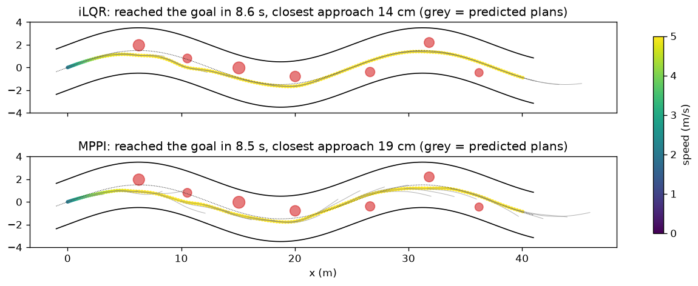

# iLQR vs MPPI: Model-Predictive Control of a Race Car Around Obstacles



Two trajectory optimisers, written from scratch in NumPy, run as 20 Hz model-predictive controllers on the same 1/10-scale car model with the same cost:

- **iLQR** (iterative LQR, Li & Todorov 2004 / Tassa et al. 2012): derivative-based. Batched finite-difference Jacobians of the dynamics, a Gauss-Newton quadratic model of a sum-of-squares cost, an LQR backward pass with regularisation, a line-searched forward pass, and warm starts between control steps.
- **MPPI** (model predictive path integral, Williams et al. 2017): sampling-based. 800 noisy control sequences rolled out in parallel (vectorised NumPy) and averaged with exponential weights. No derivatives needed.
- **Vehicle:** dynamic bicycle model with Pacejka-style tyre forces (slip angles, friction limit), steering and acceleration limits, RK4 integration.
- **Task:** a winding 4 m wide, 40 m road with 7 random obstacles and a 5 m/s target speed. Each planner is tested on random layouts, with an exact model and with **40% less tyre grip than the planner's model** (model mismatch).

## Results

```text
1/10-scale car (dynamic bicycle, Pacejka-style tyres), 20 Hz MPC, 1.25 s horizon
Winding 4 m road, 40 m long, 7 random obstacles; target speed 5.0 m/s; 10 random layouts, 10 parallel workers

case                      planner   success  collisions  off-road     time  min clearance  steer rate  compute/step
model = reality           iLQR       10/10          0         0   8.76 s          14 cm      12 °/s         42 ms
model = reality           MPPI       10/10          0         0   8.66 s          14 cm      69 °/s         29 ms

40% less grip than model  iLQR        9/10          1         0   8.83 s          11 cm      21 °/s         54 ms
40% less grip than model  MPPI       10/10          0         0   8.85 s          19 cm      72 °/s         31 ms

min clearance = mean over layouts of the closest approach to any obstacle (negative = hit)
steer rate = mean |change in steering| per second (lower = smoother)
(ran in 29 s)
saved ilqr_vs_mppi.png
```

## Run it

```bash
python3 -m venv .venv && source .venv/bin/activate
pip install -r requirements.txt
python tests.py                 # quick self-checks
python main.py                  # runs in parallel on all cores; a few minutes on an M-series Mac
python main.py --layouts 5      # quicker
```

## Files

- `car.py`: vectorised dynamic bicycle model with tyre forces, RK4 step
- `task.py`: road, obstacles, and the residual (sum-of-squares) cost
- `planners.py`: iLQR and MPPI
- `main.py`: closed-loop experiments over random layouts, plot
- `tests.py`: dynamics sanity checks; both optimisers must lower the plan cost

## Limitations

- Python speed: about 0.1 s per control step here. Real-time versions run on a GPU (MPPI) or in C++ (iLQR).
- Obstacles are soft penalties, not hard constraints. Constrained iLQR (augmented Lagrangian) or a safety filter (see Project 17) would give guarantees.
- The car model has no load transfer or longitudinal tyre slip.
